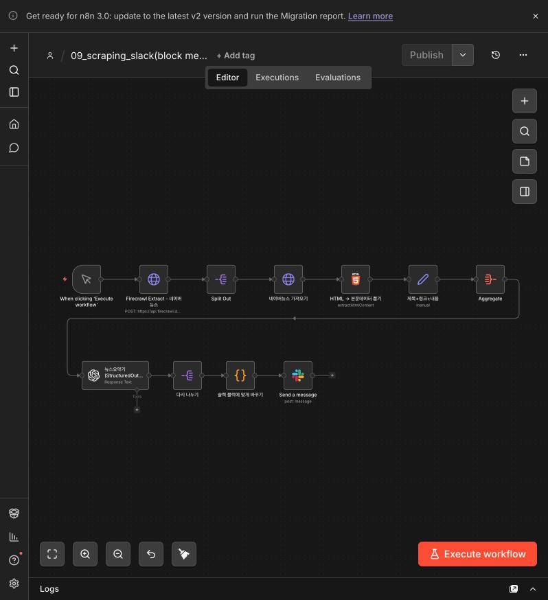

# IT 뉴스 3줄 요약 Slack 리포트

> IT 뉴스를 모아 3줄 요약으로 Slack에 보내는 리포트 (n8n · Firecrawl · OpenAI)

**흐름**

```
Manual/Schedule Trigger
  └─ Firecrawl로 네이버 IT 뉴스 목록 수집 → Split Out → 기사별 본문 요청 → HTML 본문 추출   ← 규칙
       └─ 제목·링크·본문 정리 → Aggregate
            └─ 뉴스요약기 (OpenAI, Structured Output: 3줄 요약)                          ← AI
                 └─ Slack Block Kit 형식으로 변환 (Code) → Slack 전송                      ← 규칙
```

**규칙 / AI 경계** — 수집·추출·전송은 전부 규칙 노드. AI는 **본문을 3줄로 요약하는 한 단계**에만 쓰고, 출력은 Structured Output으로 받아 Slack 블록에 그대로 꽂히게 했다. 요약 품질이 흔들려도 전송 포맷은 깨지지 않는다.



## 사용

1. n8n → Workflows → Import from File → `workflows/07_news_digest_slack_report.json`
2. 각 노드의 credential을 본인 계정으로 연결
3. placeholder 교체: `SLACK_ID` `YOUR_API_KEY`

credential과 외부 ID는 모두 placeholder로 바꿔 두었습니다.

## 환경

n8n (self-hosted, Docker) · Firecrawl · 네이버뉴스 · OpenAI · Slack

---

다른 n8n 워크플로우와 규칙/AI를 나누는 기준은 [n8n-automation-workflows](https://github.com/sikumdev/n8n-automation-workflows)에 정리했습니다.
